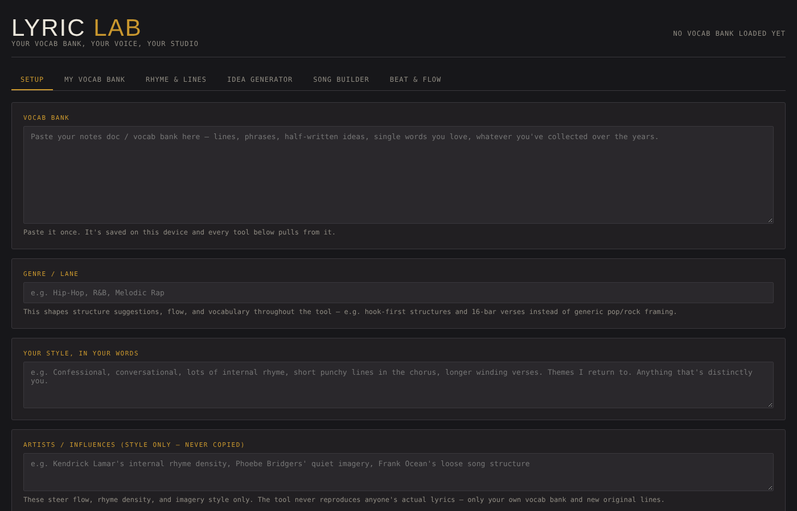

# ✍️ Lyric Lab

**Live demo:** https://jaxzader.github.io/lyric-lab/ (AI tabs need your own API key; vocab search and BPM detection work without one)

An AI songwriting tool that writes *from your own notebook*. You paste in your personal vocab bank (lines, phrases, ideas you've collected), and the tool uses an LLM to generate rhymes, ideas, and song drafts that remix your own words in your style.

## What it does

| Tab | What it does |
|---|---|
| **Setup** | Paste your vocab bank, describe your style, and list stylistic influences. Saved in your browser. |
| **My Vocab Bank** | Search your own notebook instantly (no AI needed). |
| **Rhyme & Lines** | Give it a word or line and get rhymes and new lines built from your vocab. |
| **Idea Generator** | Generates 5–12 song ideas from a theme or spark. |
| **Song Builder** | Set the key, BPM, and length, build sections with a rhyme scheme for each (or let the AI choose and explain why), and draft the full song in your voice. |
| **Beat & Flow** | Upload an instrumental to estimate its BPM and length with audio signal analysis (no AI). Or upload a voice memo humming a cadence: it detects where the beats land and asks the AI to write lines whose syllables fit that rhythm. |

## Design choices

- **Your words first.** The prompt tells the model to pull from and remix *your* vocab bank before using generic phrasing.
- **Guardrails against copying.** Influences only steer style (rhyme density, imagery, structure). The system prompt forbids reproducing any real artist's lyrics, and all output must be original.
- **Long-notebook sampling.** Large vocab banks are sampled from the start, middle, and end so the model sees variety instead of just the first page.
- **AI only where it helps.** BPM detection and vocab search are plain code (Web Audio API and text search); the LLM is used only for creative writing.
- **Single file.** One HTML file with no build step.

## Tech

HTML · CSS · JavaScript · Web Audio API · Anthropic Claude API · localStorage

## Run it

Open `index.html` in a browser. To use the AI tools, add your own Anthropic API key in **Setup**. It's stored only in your browser. The vocab search works without a key.

---
Built by **Jax Zader** · AI in Business, Arizona State University · [LinkedIn](https://linkedin.com/in/jaxzader)
